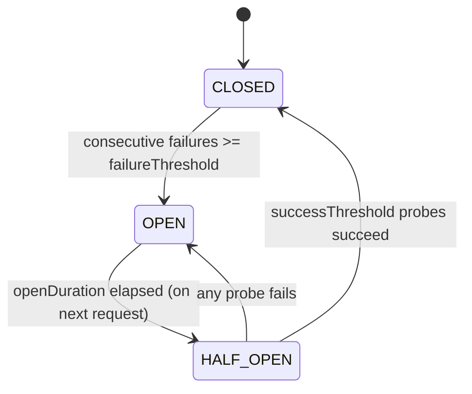

# circuitBreaker

A small, dependency-free Java implementation of the **Circuit Breaker** pattern, written as a low-level design (LLD) exercise. It protects calls to a flaky remote dependency: it stops hammering a failing service, waits out a cool-down period, and then verifies recovery with a limited number of probe requests before resuming normal traffic.

The whole implementation is 323 lines of plain Java across ten files, with no third-party dependencies and no build tooling.

> **Review status** — sources re-reviewed at commit `b6bcd965` (8 November 2026) and re-checked on 13 November 2026. No Java source has changed since `8a101c2` (1 November 2026): all five commits after it touch only `README.md`, which a tree comparison of the two commits confirms. The ten sources were recompiled and re-exercised for this pass — they compile cleanly on Temurin 17.0.21, `-Xlint:all` still produces exactly one warning, and a 43-check harness drives every transition, boundary and failure path described below; all 43 checks pass. Sixteen review findings are recorded at the end, none of which break the happy path — but note 1 is not merely counter noise: it makes the branch in note 2 reachable, and that path reopens the breaker after a *successful* probe, while note 16 lets a caller-side bug open the breaker against a healthy dependency. The harness lives outside this repository — see [Build and run](#build-and-run).

---

## Overview

The breaker moves between three states:

| State | Behaviour |
| --- | --- |
| `CLOSED` | Normal operation. Every request is executed and its outcome recorded. Consecutive failures are counted; a success resets the count. |
| `OPEN` | The dependency is considered unhealthy. Requests are rejected immediately with `CircuitBreakerOpenException` — the protected service is **not** called. |
| `HALF_OPEN` | Cool-down has elapsed. A limited number of probe requests are allowed through to test recovery. |



The `OPEN -> HALF_OPEN` edge is driven from inside `OpenState.allowRequest`, so the first request that arrives after the cool-down is the first probe. There is no background timer.

---

## Project structure

```text
lld/circuitbreaker/
├── circuit-breaker-design.md          # Design notes, state flow, scope
├── config/
│   └── CircuitBreakerConfig.java      # Thresholds + cool-down duration (record, validated)
├── core/
│   └── CircuitBreakerOrchestrator.java# Owns current state, coordinates transitions
├── state/
│   ├── CircuitBreakerState.java       # State-pattern interface
│   ├── ClosedState.java
│   ├── OpenState.java
│   └── HalfOpenState.java
├── metrics/
│   └── CircuitBreakerMetrics.java     # Request / success / failure counters + last timestamp
└── facade/
    ├── CircuitBreakerFacade.java      # Public entry point
    ├── CircuitBreakerRequest.java     # Functional interface for the protected call
    └── CircuitBreakerOpenException.java
```

| Component | Responsibility | Lines |
| --- | --- | --- |
| `CircuitBreakerFacade` | Public API. Runs the protected request, records the outcome, exposes state and metrics. | 52 |
| `CircuitBreakerOrchestrator` | Holds the current state object and the counters that drive transitions. | 88 |
| `CircuitBreakerState` | State-pattern interface implemented by the three concrete states. | 12 |
| `CircuitBreakerConfig` | Immutable, validated thresholds and cool-down duration. | 23 |
| `CircuitBreakerMetrics` | Thread-safe counters for requests, successes, failures and the last activity timestamp. | 44 |
| `CircuitBreakerRequest<T>` | `@FunctionalInterface` for the call being protected. | 6 |

---

## Configuration

```java
CircuitBreakerConfig config = new CircuitBreakerConfig(
        3,                      // failureThreshold   – consecutive failures that trip CLOSED -> OPEN
        2,                      // halfOpenThreshold  – maximum probes admitted while HALF_OPEN
        2,                      // successThreshold   – successful probes needed to close again
        Duration.ofSeconds(30)  // openDuration       – cool-down before probing resumes
);
```

The compact constructor rejects invalid input, so a misconfigured breaker fails fast at construction time rather than misbehaving at runtime:

- every threshold must be `>= 1`;
- `successThreshold` must not exceed `halfOpenThreshold`;
- `openDuration` must be a positive, non-null `Duration`.

All seven invalid combinations that exercise these rules were run against the record — zero and negative thresholds, `successThreshold > halfOpenThreshold`, and zero, negative and `null` durations — and every one raises `IllegalArgumentException`.

---

## Usage

Wrap **only** the external service call — not local business logic — so that the breaker's failure count reflects the dependency, not the caller.

```java
CircuitBreakerConfig config = new CircuitBreakerConfig(
        3, 2, 2, Duration.ofSeconds(30));

CircuitBreakerFacade breaker = new CircuitBreakerFacade(config);

try {
    PaymentResponse response = breaker.executeCircuitBreaker(
            () -> paymentClient.charge(paymentRequest));
    // use the response
} catch (CircuitBreakerOpenException exception) {
    // Breaker is OPEN: the dependency was not called.
    // Return a cached/fallback value, enqueue for retry, or ask the caller to try later.
} catch (RuntimeException exception) {
    // The dependency was called and failed; the failure has been recorded.
}
```

The facade also accepts an injected `java.time.Clock`, which makes the cool-down window deterministic in tests:

```java
CircuitBreakerFacade breaker = new CircuitBreakerFacade(config, fixedClock);
```

---

## API

| Method | Description |
| --- | --- |
| `<T> T executeCircuitBreaker(CircuitBreakerRequest<T>)` | Runs the protected call if the breaker allows it. Returns the call's result, or throws. |
| `String getCircuitBreakerState()` | Current state name: `"CLOSED"`, `"OPEN"` or `"HALF_OPEN"`. |
| `CircuitBreakerMetrics getMetrics()` | The live metrics object for this breaker — see the note below. |

### What `executeCircuitBreaker` does

- **Allowed and the call succeeds** — returns the value, records a success, and closes the breaker if enough probes succeeded.
- **Breaker is `OPEN`** — throws `CircuitBreakerOpenException` *without* invoking the callback. This check happens before the `try` block, so the rejection is never wrapped.
- **The callback throws** — records a failure, updates the state if the failure threshold is reached, and rethrows as a `RuntimeException` whose `cause` is the original exception.
- **The callback throws an `Error`** — not caught at all. The `Error` propagates, no failure is recorded, and the breaker is left unchanged.

### Metrics

`CircuitBreakerMetrics` exposes `getRequestNo()`, `getSuccessCount()`, `getFailureCount()` and `getTimestamp()`, all `synchronized`.

`getMetrics()` returns the breaker's own mutable metrics object, not a copy — a reference held by a caller sees every later write. Read it as a live handle, not a snapshot.

`requestNo` counts every request the facade sees, including rejected ones, so the rejection count is:

```java
long rejected = metrics.getRequestNo() - metrics.getSuccessCount() - metrics.getFailureCount();
```

That arithmetic is the only way to see rejections today; see review note 4.

---

## Build and run

The repository ships sources only — there is no `pom.xml` or `build.gradle`, and the files sit under `lld/` rather than a Maven `src/main/java` layout. To compile and use them, either add the standard build tooling or compile directly:

```bash
javac -d out $(find lld -name '*.java')
```

The sources declare `package com.example.demo.lld.circuitbreaker.*` but sit under `lld/circuitbreaker/`, so the tree does not mirror the package path. The command above still works because `javac` does not check that layout for files it is given explicitly; the moment a `pom.xml` is added, the sources have to move to `src/main/java/com/example/demo/lld/...`.

Requires **JDK 17+** (`CircuitBreakerConfig` is a `record`). Verified with Temurin 17.0.21: the ten sources compile with no errors, and `-Xlint:all` produces exactly one warning — a missing `serialVersionUID` on `CircuitBreakerOpenException`.

### Verified behaviour

Every row below was produced by running the sources — a throwaway harness in the default package, driven by a hand-advanced `Clock`, asserting 43 expectations across the state machine, the metrics, the exception paths and a 126-configuration sweep of the transition logic.

| Scenario | Observed |
| --- | --- |
| 3 consecutive failures with `failureThreshold = 3` | states `CLOSED, CLOSED, CLOSED, OPEN`; the next request throws `CircuitBreakerOpenException` |
| Success between failure runs | resets the counter — two failures, one success, two more failures leaves the breaker `CLOSED` |
| `openDuration = 30s` | rejected at `t+29.999s`, admitted at `t+30.000s` and the state becomes `HALF_OPEN` |
| `halfOpenThreshold = 3` | probes 1–3 admitted, probe 4 rejected |
| Probe counter vs. probes admitted | `halfOpenThreshold = 2`: five `allowRequest` calls admit two probes and leave the counter at 5 |
| Probe succeeds, then a probe fails | stays `HALF_OPEN` after the success, reopens on the failure |
| One success and one failure plus two rejections | `requestNo = 4`, `successCount = 1`, `failureCount = 1`, so two requests are unaccounted for in the counters |
| Metrics handle retained by a caller | sees later writes — it is the live object, not a snapshot |
| Slow call | a call that finished 10s later was timestamped with its *start* time |
| Domain `RuntimeException` from the callback | comes back as `java.lang.RuntimeException` with the domain exception as `cause` |
| `AssertionError` from the callback | escapes uncaught, breaker stays `CLOSED`, `failureCount` stays `0` |
| Nested breaker rejects | the outer breaker records the inner `CircuitBreakerOpenException` as a dependency failure |
| `canTryHalfOpen` while `CLOSED` | throws `NullPointerException` on the unset `openedAt` |
| All seven invalid configs | `IllegalArgumentException` |
| `else if` branch in `HalfOpenState.onSuccess` | never taken across 126 valid `(failureThreshold, halfOpenThreshold, successThreshold)` combinations with no rejected requests; taken — and the breaker reopens on a success — once rejections have inflated the probe counter (note 2) |
| `null` request passed to the facade | the `NullPointerException` is caught and recorded as a dependency failure; three such calls take a healthy breaker to `OPEN` (note 16) |

These confirm the review notes below rather than contradicting them.

---

## Design notes

The implementation is a small case study in the SOLID principles:

- **Single responsibility** — the facade composes; the orchestrator owns state; the state classes own transitions; config and metrics are separate value/counter objects.
- **Open/closed** — a new state is a new `CircuitBreakerState` implementation; the facade API does not change.
- **State pattern** — `ClosedState`, `OpenState` and `HalfOpenState` encapsulate the policy for each phase, replacing nested `if`/`switch` blocks.
- **Dependency injection for time** — `Clock` is injected into the facade, so cool-down behaviour is testable without sleeping.
- **Fail-fast configuration** — validation lives in the config record, not scattered through the runtime path.
- **Interface segregation** — callers depend on a three-method facade; `CircuitBreakerRequest` is a one-method functional interface with no baggage.

Scored against the five SOLID principles and a modularity check:

| Principle | Verdict | Where it holds — and where it strains |
| --- | --- | --- |
| Single responsibility | Holds | Facade composes, orchestrator transitions, states own policy, config validates, metrics count. One blur: the orchestrator resets probe counters that the states logically own (note 3). |
| Open/closed | Holds | A fourth state is a new `CircuitBreakerState` implementation; neither the facade nor the public API changes. |
| Liskov substitution | Holds | All three states honour the same four-method contract. `OpenState.allowRequest` delegating to a freshly created `HalfOpenState` is the only cross-state call, and it respects the contract. |
| Interface segregation | Holds | `CircuitBreakerRequest` is a one-method functional interface; callers see three facade methods. `CircuitBreakerState` is state-internal but carries a `name()` unrelated to transitions (note 14). |
| Dependency inversion | Strains | `Clock` is injected, but the facade `new`s its orchestrator and metrics and the orchestrator `new`s its states (note 12); `core` and `state` depend on each other (note 13). |

On modularity the layout is one package per concern, ten single-purpose files of 6–88 lines, no static mutable state and no third-party imports. The one structural defect is the `core` ↔ `state` package cycle; everything else separates cleanly.

---

## Known limitations

- **No retries, fallbacks, timeouts or async execution.** The facade wraps exactly one call. The missing timeout is the significant one: a dependency that hangs rather than fails never records an outcome, so the breaker stays `CLOSED` and every caller blocks. Without a timeout the breaker cannot deliver its main promise — failing fast.
- **Consecutive-failure counting only.** A slow trickle of failures across a long period is treated the same as a burst; a rolling failure-rate window would be more realistic in production.
- **Single instance.** Metrics and state are in-process; there is no shared/distributed breaker state.
- **Check and record are not atomic across threads.** `allowRequest` and `record*` are individually `synchronized`, but a request is admitted and recorded in two separate critical sections, so concurrent callers can interleave. Worse, an outcome is applied to whichever state is current when it is recorded: a probe admitted in `HALF_OPEN` whose result lands after another thread has reopened the breaker is handed to `OpenState`, which ignores it. See review notes 9 and 10.
- **No structured logging or metric export.** Counters are readable in-process only.

### Review notes

A line-by-line read of the sources at `b6bcd965` — unchanged since `8a101c2` — backed by the harness runs above, surfaced the following. None affect the happy path; all are worth addressing before production use.

| # | Severity | Finding | Where |
| --- | --- | --- | --- |
| 1 | High | Probe slot consumed before the admission check | `HalfOpenState.allowRequest` |
| 2 | Medium | `else if` branch unreachable only once note 1 is fixed | `HalfOpenState.onSuccess` |
| 3 | Medium | Counters reset by the orchestrator, not the states | `CircuitBreakerOrchestrator` |
| 4 | Medium | Rejections invisible in the metrics | `CircuitBreakerMetrics` |
| 5 | Medium | Outcome timestamps are start times | `CircuitBreakerFacade` |
| 6 | Medium | `catch (Exception)` misses `Error` | `CircuitBreakerFacade` |
| 7 | Medium | Every exception is re-wrapped | `CircuitBreakerFacade` |
| 8 | Medium | A nested breaker's rejection is treated as a failure | `CircuitBreakerFacade` |
| 9 | Medium | Wide, unsynchronized mutation surface | `CircuitBreakerOrchestrator` |
| 10 | Medium | Outcomes applied to the state current at record time | `CircuitBreakerOrchestrator` |
| 11 | Low | `canTryHalfOpen` can NPE | `CircuitBreakerOrchestrator` |
| 12 | Low | `new` inside the composition root | `CircuitBreakerFacade` |
| 13 | Low | Package cycle `core` ↔ `state` | `core`, `state` |
| 14 | Low | String state names and a loose callback signature | `CircuitBreakerState`, `CircuitBreakerRequest` |
| 15 | Low | Null `Clock`/config not rejected at construction | `CircuitBreakerFacade` |
| 16 | Medium | Caller-side bugs are counted as dependency failures | `CircuitBreakerFacade` |

1. **`HalfOpenState.allowRequest` mutates state before it decides.** It calls `incrementHalfOpenProbeCount()` and then compares, so a request that is *rejected* has still consumed a probe slot. With `halfOpenThreshold = 2`, five `allowRequest` calls admit two probes and leave the counter at 5; it keeps climbing for every rejected request during a long `OPEN` spell. Increment only after the check passes. This is also the defect that keeps note 2 alive, so it is worth fixing before anything else.
2. **The `else if` branch in `HalfOpenState.onSuccess` is unreachable under correct counting — and live under today's.** With `successThreshold <= halfOpenThreshold` enforced by the config, and a close firing the moment the success count reaches the threshold, a run of successful probes reaches `successThreshold` before the probe count can run out, so the branch cannot be taken; brute-forcing the 126 valid `(failureThreshold, halfOpenThreshold, successThreshold)` configs never took it. It is reachable today only because note 1 lets *rejected* requests inflate `halfOpenProbeCount`. With `failureThreshold = 3, halfOpenThreshold = 3, successThreshold = 2`: three probes are admitted, two further requests are rejected but still counted, the counter reaches 5, and the next successful probe finds `successCount = 1 < 2` while `probeCount = 5 >= 3` — so the breaker **reopens on a success**. A model of the state machine reproduces exactly this. Fix note 1 and the branch becomes genuinely dead; delete it (or turn it into an assertion) at the same time.
3. **Probe counters are reset only on transitions.** `halfOpenProbeCount` and `halfOpenSuccessCount` are cleared in `open()`, `halfOpen()` and `close()`, which works today but makes the state objects depend on the orchestrator clearing them at exactly the right moments. `consecutiveFailures` is reset only in `close()`, so it silently carries a stale value through every `OPEN -> HALF_OPEN -> OPEN` cycle. Letting each state own its own counters would remove the coupling.
4. **Rejected requests are invisible in the metrics.** `recordRejected` bumps `requestNo` but there is no `rejectedCount`, so `requestNo != successCount + failureCount` with no first-class way to account for the gap. Add the counter, or a `getRejectedCount()` computed from the three that exist.
5. **Metric timestamps are start times.** The facade captures `now` once, before the call, and records it afterwards, so a slow call is timestamped at its start — a 10-second call is stamped 10 seconds early. Capture the clock again when recording the outcome; that also makes latency measurable.
6. **`catch (Exception)` does not catch `Error`.** A dependency that throws `Error` never trips the breaker; the `Error` escapes and the breaker stays `CLOSED` with `failureCount` still at 0. `catch (Throwable)` with a careful rethrow, or at minimum documenting the choice, would be safer.
7. **Exceptions are always re-wrapped.** Even a `RuntimeException` from the callback comes back wrapped in a new `RuntimeException`, so callers cannot catch their own domain exception types. Rethrowing unchecked exceptions unchanged and wrapping only checked ones is friendlier.
8. **A nested breaker's rejection is treated as a failure.** If the protected call itself goes through another circuit breaker and that breaker throws `CircuitBreakerOpenException`, this breaker records it as a dependency failure and wraps it. The two cases — "the dependency is down" and "we did not call the dependency" — need to be distinguishable.
9. **`CircuitBreakerOrchestrator` exposes a wide mutation surface.** `open()`, `halfOpen()`, `close()` and the `increment*` methods are `public` and unsynchronized, so the state objects and any other caller can drive transitions. They are only safe because they happen to be called from inside synchronized methods. Narrowing this to a package-private transition interface would enforce the invariants.
10. **An outcome is applied to whatever state is current when it is recorded.** `recordSuccess`/`recordFailure` dispatch on `state` at record time, not on the state that admitted the request. A `HALF_OPEN` probe whose result arrives after the breaker reopened has its outcome swallowed by `OpenState`'s no-op handlers, so a healthy dependency can be declared down on the strength of stale results. Carrying the admitting state (or a per-request token) through the call would fix both this and the counter skew in note 1.
11. **`canTryHalfOpen` can NPE.** It dereferences `openedAt` with no null check; calling it while the breaker is `CLOSED` throws `NullPointerException` on `openedAt.plus(...)`. It is only safe because `open()` always sets the field first. A guard (or returning `false`) makes the contract explicit.
12. **`new` inside the composition root.** The facade constructs its orchestrator and metrics directly, and the orchestrator constructs its state objects. Injecting them (or a factory) would make unit testing and mocking much easier.
13. **Package cycle.** `core` imports `state` while every state imports `core`. It works, but it is the one structural smell in an otherwise clean package layout — extracting a small transition/context type both packages can depend on would break the cycle.
14. **Two small API nits.** `getCircuitBreakerState()` returns a `String` and `CircuitBreakerState.name()` hand-rolls what an enum would give for free, so callers cannot switch on the state without string matching; and `CircuitBreakerRequest.execute() throws Exception` is looser than the contract the facade actually honours, since everything emerges as a `RuntimeException` anyway. Finally, `CircuitBreakerOpenException` has no `serialVersionUID` — the only `-Xlint:all` warning in the build.
15. **The facade does not fail fast on null collaborators.** `CircuitBreakerFacade(config, clock)` assigns both fields with no null check, so `new CircuitBreakerFacade(config, null)` constructs happily and only throws `NullPointerException` from `clock.instant()` on the first request — the opposite of the fail-fast behaviour the config record earns. `Objects.requireNonNull` in the constructor moves the failure to construction time.
16. **A caller-side bug is recorded as a dependency failure.** The facade wraps only `request.execute()`, but everything inside that `try` is blamed on the dependency — including a `null` request, whose `NullPointerException` comes from invoking the lambda itself, and any `NullPointerException` the caller's own code throws before it reaches the network. With `failureThreshold = 3`, three `executeCircuitBreaker(null)` calls take a healthy breaker to `OPEN`, so the next real caller is rejected for a fault that never touched the dependency. `Objects.requireNonNull(request)` before the `try` removes the `null` case; the rest is the price of a lambda-shaped API, and the usage rule above — wrap only the external service call — is the mitigation.

### Suggested next steps

1. Fix notes 1, 5, 10 and 16 — they are the ones that can produce wrong decisions, not just noisy counters. Note 1 comes first: it is the only reason note 2 can reopen a recovering breaker.
2. Add a timeout wrapper around the callback; without it the breaker cannot fail fast on a hung dependency.
3. Add a `rejectedCount` and a `snapshot()` method so metrics are readable without holding the live object.
4. Add JUnit 5 tests using the injected `Clock`, plus a `pom.xml` so the sources leave `lld/` for `src/main/java`.

---

See [`lld/circuitbreaker/circuit-breaker-design.md`](lld/circuitbreaker/circuit-breaker-design.md) for the original design write-up.
