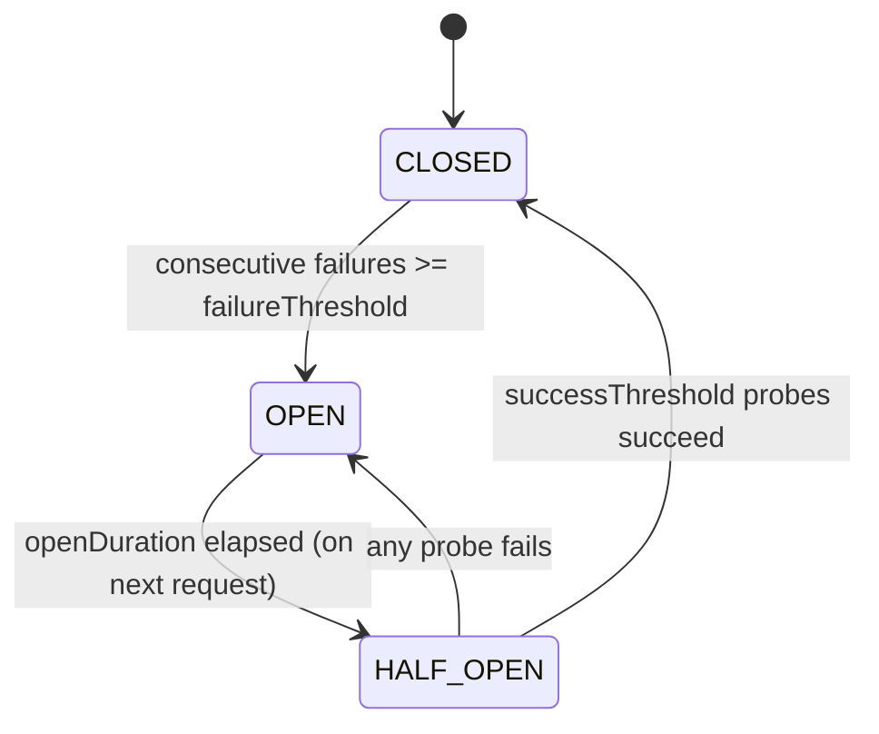

# circuitBreaker

A small, dependency-free Java implementation of the **Circuit Breaker** pattern, written as a low-level design (LLD) exercise. It protects calls to a flaky remote dependency: it stops hammering a failing service, waits out a cool-down period, and then verifies recovery with a limited number of probe requests before resuming normal traffic.

The whole implementation is ~400 lines of plain Java with no third-party dependencies.

---

## Overview

The breaker moves between three states:

| State | Behaviour |
| --- | --- |
| `CLOSED` | Normal operation. Every request is executed and its outcome recorded. Consecutive failures are counted; a success resets the count. |
| `OPEN` | The dependency is considered unhealthy. Requests are rejected immediately with `CircuitBreakerOpenException` — the protected service is **not** called. |
| `HALF_OPEN` | Cool-down has elapsed. A limited number of probe requests are allowed through to test recovery. |



---

## Project structure

```text
lld/circuitbreaker/
├── circuit-breaker-design.md          # Design notes, state flow, scope
├── config/
│   └── CircuitBreakerConfig.java      # Thresholds + cool-down duration (record, validated)
├── core/
│   └── CircuitBreakerOrchestrator.java# Owns current state, coordinates transitions
├── state/
│   ├── CircuitBreakerState.java       # State-pattern interface
│   ├── ClosedState.java
│   ├── OpenState.java
│   └── HalfOpenState.java
├── metrics/
│   └── CircuitBreakerMetrics.java     # Request / success / failure counters + last timestamp
└── facade/
    ├── CircuitBreakerFacade.java      # Public entry point
    ├── CircuitBreakerRequest.java     # Functional interface for the protected call
    └── CircuitBreakerOpenException.java
```

| Component | Responsibility |
| --- | --- |
| `CircuitBreakerFacade` | Public API. Runs the protected request, records the outcome, exposes state and metrics. |
| `CircuitBreakerOrchestrator` | Holds the current state object and the counters that drive transitions. |
| `CircuitBreakerState` | State-pattern interface implemented by the three concrete states. |
| `CircuitBreakerConfig` | Immutable, validated thresholds and cool-down duration. |
| `CircuitBreakerMetrics` | Thread-safe counters for requests, successes, failures and the last activity timestamp. |
| `CircuitBreakerRequest<T>` | `@FunctionalInterface` for the call being protected. |

---

## Configuration

```java
CircuitBreakerConfig config = new CircuitBreakerConfig(
        3,                      // failureThreshold   – consecutive failures that trip CLOSED -> OPEN
        2,                      // halfOpenThreshold  – maximum probes admitted while HALF_OPEN
        2,                      // successThreshold   – successful probes needed to close again
        Duration.ofSeconds(30)  // openDuration       – cool-down before probing resumes
);
```

The compact constructor rejects invalid input, so a misconfigured breaker fails fast at construction time rather than misbehaving at runtime:

- every threshold must be `>= 1`;
- `successThreshold` must not exceed `halfOpenThreshold`;
- `openDuration` must be a positive, non-null `Duration`.

---

## Usage

Wrap **only** the external service call — not local business logic — so that the breaker's failure count reflects the dependency, not the caller.

```java
CircuitBreakerConfig config = new CircuitBreakerConfig(
        3, 2, 2, Duration.ofSeconds(30));

CircuitBreakerFacade breaker = new CircuitBreakerFacade(config);

try {
    PaymentResponse response = breaker.executeCircuitBreaker(
            () -> paymentClient.charge(paymentRequest));
    // use the response
} catch (CircuitBreakerOpenException exception) {
    // Breaker is OPEN: the dependency was not called.
    // Return a cached/fallback value, enqueue for retry, or ask the caller to try later.
} catch (RuntimeException exception) {
    // The dependency was called and failed; the failure has been recorded.
}
```

The facade also accepts an injected `java.time.Clock`, which makes the cool-down window deterministic in tests:

```java
CircuitBreakerFacade breaker = new CircuitBreakerFacade(config, fixedClock);
```

---

## API

| Method | Description |
| --- | --- |
| `<T> T executeCircuitBreaker(CircuitBreakerRequest<T>)` | Runs the protected call if the breaker allows it. Returns the call's result, or throws. |
| `String getCircuitBreakerState()` | Current state name: `"CLOSED"`, `"OPEN"` or `"HALF_OPEN"`. |
| `CircuitBreakerMetrics getMetrics()` | Snapshot accessors for counters. |

### What `executeCircuitBreaker` does

- **Allowed and the call succeeds** — returns the value, records a success, and closes the breaker if enough probes succeeded.
- **Breaker is `OPEN`** — throws `CircuitBreakerOpenException` *without* invoking the callback.
- **The callback throws** — records a failure, updates the state if the failure threshold is reached, and rethrows as a `RuntimeException` whose `cause` is the original exception.

### Metrics

`CircuitBreakerMetrics` exposes `getRequestNo()`, `getSuccessCount()`, `getFailureCount()` and `getTimestamp()`, all `synchronized`.

---

## Build and run

The repository currently ships sources only — there is no `pom.xml` or `build.gradle`, and the files sit under `lld/` rather than a Maven `src/main/java` layout. To compile and use them, either add the standard build tooling or compile directly:

```bash
javac -d out $(find lld -name '*.java')
```

Requires **JDK 17+** (`CircuitBreakerConfig` is a `record`). The sources compile cleanly; the only `-Xlint:all` warning is a missing `serialVersionUID` on `CircuitBreakerOpenException`.

---

## Design notes

The implementation is a small case study in the SOLID principles:

- **Single responsibility** — the facade composes; the orchestrator owns state; the state classes own transitions; config and metrics are separate value/counter objects.
- **Open/closed** — a new state is a new `CircuitBreakerState` implementation; the facade API does not change.
- **State pattern** — `ClosedState`, `OpenState` and `HalfOpenState` encapsulate the policy for each phase, replacing nested `if`/`switch` blocks.
- **Dependency injection for time** — `Clock` is injected into the facade, so cool-down behaviour is testable without sleeping.
- **Fail-fast configuration** — validation lives in the config record, not scattered through the runtime path.

---

## Known limitations

- **No retries, fallbacks, timeouts or async execution.** The facade wraps exactly one call.
- **Consecutive-failure counting only.** A slow trickle of failures across a long period is treated the same as a burst; a rolling failure-rate window would be more realistic in production.
- **Single instance.** Metrics and state are in-process; there is no shared/distributed breaker state.
- **Check and record are not atomic across threads.** `allowRequest` and `record*` are individually `synchronized`, but a request is admitted and recorded in two separate critical sections, so concurrent callers can interleave (see review notes below).
- **No structured logging or metric export.** Counters are readable in-process only.

### Review notes

A read-through of the current sources surfaced the following points, none of which affect the happy path but all of which are worth addressing before production use:

1. **`HalfOpenState.allowRequest` mutates state.** It calls `incrementHalfOpenProbeCount()` and then compares, so a request that ends up *rejected* has still consumed a probe slot. Increment only after the check passes.
2. **The `else if` branch in `HalfOpenState.onSuccess` is effectively dead.** Given `successThreshold <= halfOpenThreshold` and immediate reopening on any failed probe, the "ran out of probes without enough successes" branch cannot be reached through the normal flow; it hides intent rather than guarding a real case.
3. **Probe counters reset only on transitions.** `halfOpenProbeCount` and `halfOpenSuccessCount` are cleared in `open()`, `halfOpen()` and `close()`, which is fine today but makes the state objects depend on the orchestrator clearing them at the right moments.
4. **Rejected requests are invisible in metrics.** `recordRejected` bumps `requestNo` but there is no `rejectedCount`, so `requestNo != successCount + failureCount` with no way to account for the gap.
5. **Metric timestamps are start times.** The facade captures `now` once, before the call, and records it afterwards, so a slow call is timestamped at its start. Capture the clock again when recording the outcome.
6. **`catch (Exception)` does not catch `Error`.** A dependency that throws `Error` (or an unchecked failure that escapes as one) will never trip the breaker. `catch (Throwable)` with careful rethrow, or at minimum documenting the choice, would be safer.
7. **Exceptions are always re-wrapped.** Even a `RuntimeException` from the callback comes back wrapped in a new `RuntimeException`, so callers cannot catch their own domain exception types. Rethrowing unchecked exceptions unchanged and wrapping only checked ones is friendlier.
8. **`CircuitBreakerOrchestrator` exposes a wide mutation surface.** `open()`, `halfOpen()`, `close()` and the `increment*` methods are `public` and unsynchronized, so the state objects and any other caller can drive transitions. Narrowing this to a package-private transition interface would enforce the invariants.
9. **`canTryHalfOpen` can NPE.** It dereferences `openedAt` with no null check; it is only safe because `open()` always sets it first. A guard (or returning `false`) makes the contract explicit.
10. **`new` inside the composition root.** The facade constructs its orchestrator and metrics directly, and the orchestrator constructs its state objects. Injecting them (or a factory) would make unit testing and mocking much easier.
11. **Package cycle.** `core` imports `state` while every state imports `core`. It works, but it is the one structural smell in an otherwise clean package layout — extracting a small transition/context type both packages can depend on would break the cycle.
12. **No tests.** The `Clock` injection is already in place; a handful of deterministic tests covering each transition would lock the behaviour down.

---

See [`lld/circuitbreaker/circuit-breaker-design.md`](lld/circuitbreaker/circuit-breaker-design.md) for the original design write-up.
